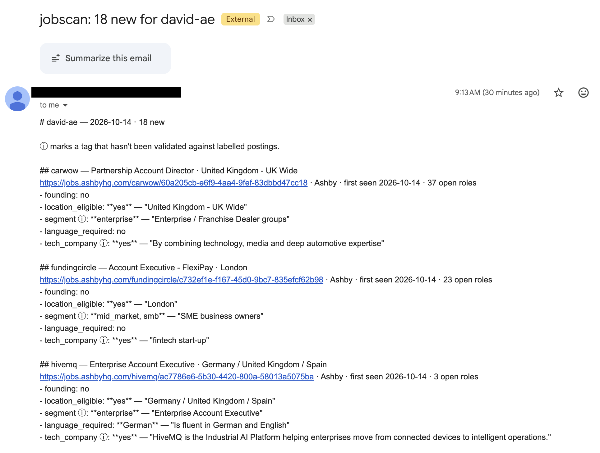

# job-board-scanner

[](https://github.com/holarchic/job-board-scanner/actions/workflows/ci.yml)
[](LICENSE)

Self-hosted scanner for tech roles on Ashby, Greenhouse, Gem, Workable, Teamtailor, Personio: LLM-tagged, emailed daily.

> **Status:** running daily on my own search since October 2026, version 0.1.0. Pre-1.0: the config, the database and the digest format can still change.



## Why

For anyone after a role at tech companies who wants every new posting that matches their titles, each morning, including from companies they'd never have thought to check. I built it for my London Account Executive search.

It finds the job boards itself, reads them directly and has a language model tag each match. Answers that need evidence quote the posting, and it checks the quote is really there. It runs on your machine with your own model key, at about $0.0005 a posting.

**When not to use it:**

- You want something hosted, free and set up in a minute. [HiringCafe](https://hiring.cafe) reads company career pages, Workday included, and emails alerts.
- You need LinkedIn, Indeed or Glassdoor. This reads company boards only; [JobSpy](https://github.com/speedyapply/JobSpy) scrapes those sites.
- You want the widest list of companies and no model in the loop. [job-board-aggregator](https://github.com/Feashliaa/job-board-aggregator) indexes 20,000+ companies, Workday and Lever included, refreshed daily.

## What it does

- **Finds boards** in the three newest [Common Crawl](https://commoncrawl.org) crawls: about 4,000 on Ashby, 4,800 on Greenhouse, 1,100 on Gem, 1,000 on Teamtailor, 2,800 on Personio, 1,250 on SmartRecruiters, 1,700 on Rippling, 4,200 Workday sites and 1,500 Oracle Recruiting Cloud sites. About 8,000 of the Ashby and Greenhouse ones answer. Of my hand-built list it finds 111 of 114 Ashby boards, 33 of 37 Greenhouse ones and all 4 on Gem.
- **Reads Workable boards you list** in a boards file. Discovery would find about 5,300, but Workable rate-limits a full daily sweep, so it doesn't attempt one.
- **Filters** postings by your titles and locations, then **tags** each match with the model. Answers that need evidence quote the posting; a missing or unmatched quote shows ⚠. A quote that's there doesn't prove the answer right.
- **Writes a markdown digest** of what's new, and can email it and raise a Mac notification.

| Tag | Answers |
|-----|---------|
| `founding` | First and only hire in the role's function, across the company? |
| `location_eligible` | Can you work it from where you said? Visa sponsorship isn't checked; `visa_sponsorship` asks it |
| `segment` | Sales roles: enterprise, mid-market or SMB customers (one or more) |
| `language_required` | A required language other than English, or `no` |
| `tech_company` | Is the company's main business technology? |
| `reports_to` | Who the role reports to, by title (and name, if the posting gives one), or `unknown` |
| `visa_sponsorship` | Does the employer sponsor a work visa? `unknown` when the posting doesn't say |
| `credential_required` | A required specialist degree, licence or lab/clinical background outside the role's own craft, or `no` |

`reports_to`, `visa_sponsorship` and `credential_required` are opt-in: asked only when you pick them, so a search that doesn't need them pays nothing for them.

ⓘ marks the tags no labelled set has checked: `segment`, `tech_company`, `reports_to`, `visa_sponsorship`, `credential_required`, `location_eligible` outside the UK, and your own.

It works best where a few titles narrow the field and the posting answers the rest. My first runs: AE, 233 postings, 47 minutes, at least $0.11; PM, 169 postings, 7 minutes, $0.08, then 118 more from Greenhouse for $0.05.

**Limits:**

- No Lever or job sites. Teamtailor and Personio boards on a company's own domain aren't found either, nor are Workday sites outside myworkdayjobs.com or Oracle sites outside oraclecloud.com. Oracle sites with more than 10,000 jobs (Kroger, Marriott, AutoZone and a few others) can't be read. Companies that embed Greenhouse in their own careers page, such as Fivetran and Wiz, need the boards file.
- Tags label matches; only the ones you `require` hide any, and a hidden posting is still listed in one line. Every match is tagged in the end, so hiding saves nothing.
- Tests cover AE and PM postings only, with just 8 founding roles. In the five-tag test, 8 of 11 `founding: yes` answers were right.
- No funding stage or company age; the open-role count is a rough read on size.
- One search per install.

## Behaviour notes

- **One digest per posting.** A posting appears in one digest only; a repost under a new ID is new, and a role posted separately per city appears once per city.
- **Untagged matches wait.** Matches the model couldn't tag go into a later run's digest.
- **Big backlogs take a few runs.** A run tags at most 500 matches and starts no more once it has spent $1.00; both are yours to change. It takes the newest first; on a first run, where every match is new, it takes one per company in turn. The rest wait for later runs (a run still exits 0), and the digest's first line and the notification say how many. Postings already being tagged when the dollar limit is reached finish, so a run can end a little past it.
- **No new matches, no file.** A second digest on the same day gets `-2`, `-3`.
- **Company names** come from each job site, looked up once per board the first time it has a match. Ashby also gives the company's website, shown under the posting. Some Personio boards name no company and show the board name (`ddock`). A company you list in a boards file keeps your name.
- **Demo jobs** on Gem's trial and sandbox boards are skipped.
- **Workday** sites with location filters are read through them, so only jobs in your locations are fetched and the open-role count covers just those; a site without them is read whole. The company shows as Workday's account name (`autodesk`). A job a company lists on several of its Workday sites appears once.
- **Oracle** sites are read whole. The company shows as the site's title (`Uber`, `Akamai Career Site`). A job listed on several sites of one Oracle account appears once.
- **Dead boards:** a discovered board is skipped after three "not found" answers without a successful read between them. Boards you list are always tried.
- **Failed emails** aren't resent; the digest stays on disk.
- **Backups:** the first run after an upgrade copies the database into `~/.jobscan/backups` before changing anything (about 1.6 GB on my install; the two newest copies are kept, and copies you make there yourself are left alone). If the copy fails, for example on a full disk, the run stops without touching the database. To undo an upgrade, reinstall the older version and, while no run is going, copy the newest `auto-` file over `~/.jobscan/jobscan.sqlite`.

## How it works

- **Discovery:** reads each board host's captures straight from Common Crawl's index files, in about a minute. `run` refreshes the list every 30 days and when an upgrade adds a job site. If any crawl can't be read, the old list stays.
- **Fetch:** every board's public job API or feed, eight at a time on each job site, every site at once. One board's failure never stops the run.
- **Filter:** titles and locations match whole words, ignoring case, before any model call. A remote job counts when it names one of your places, a country you list by another name, or a region holding one.
- **Describe:** SmartRecruiters, Rippling, Workday and Oracle list jobs without descriptions, so each match's description is fetched on its own. If that fails, the posting waits for the next run.
- **Tag:** one model call per posting with all your tags, a strict JSON schema, and each quote checked against the posting text; up to your limits each run, newest first.
- **Store:** everything in one SQLite file under `~/.jobscan`; no runtime dependencies beyond standard-library Python.

Module by module, with the decisions behind each: [ARCHITECTURE.md](ARCHITECTURE.md).

## Requirements

macOS or Linux, and an [OpenRouter](https://openrouter.ai) API key with credit. uv fetches Python 3.11+ if you don't have it.

Measured on my install: every run fetches about 216,000 postings from Ashby and Greenhouse in about eight minutes, plus about 5,000 from Gem. A test read of every Teamtailor and Personio board fetched about 32,000 more in about three minutes, and of every SmartRecruiters and Rippling board about 210,000, without descriptions, in just over two. Workday adds about 19 minutes for 4,200 sites, reading only the 29,000 jobs in my locations. Oracle adds 9 to 11 minutes for 1,500 sites and about 330,000 jobs. Greenhouse alone is roughly 2 GB of downloads. The database grows to about 1.4 GB.

Notifications are Mac only, and the schedule runs only while you're logged in.

## Quick start

The repo is job-board-scanner; the command it installs is still `jobscan`.

```bash
curl -LsSf https://astral.sh/uv/install.sh | sh    # installs uv; skip this line and the next if you have it
source "$HOME/.local/bin/env"                       # uv, in this window
uv tool install git+https://github.com/holarchic/job-board-scanner   # fetches Python 3.11+ if needed
uv tool update-shell                                # puts jobscan on your PATH for new windows
```

Then open a new terminal window (without it, `jobscan` is "command not found"):

```bash
jobscan ui                     # a page in your browser: your search, key, email and daily run
jobscan run                    # the first run now, or wait for the daily one; prints your first digest's path
```

`run` prints the search name, the count of new postings and the digest's path, in `~/.jobscan/digests/<search>/`. Set up with `jobscan init` instead of the page? Add the daily run with `jobscan schedule --at 08:00` (Mac; on Linux it prints a cron line for `crontab -e`).

**Without uv.** With [Homebrew](https://brew.sh), install with pipx instead:

```bash
brew install pipx
PIPX_DEFAULT_BACKEND=pip pipx install https://github.com/holarchic/job-board-scanner/archive/refs/heads/main.zip
pipx ensurepath                # puts jobscan on your PATH for new windows
```

Then open a new terminal window and carry on with `jobscan ui`. `PIPX_DEFAULT_BACKEND=pip` keeps pipx from using uv, which it does by default when uv is installed (pipx 1.12 and later; older pipx ignores the setting and uses pip anyway). To update, run `pipx reinstall jobscan`: `pipx upgrade` skips it, because the version number doesn't change between updates. The same command fixes daily runs that stop after Homebrew updates its Python.

**In a browser.** `jobscan ui` opens a page on your own machine that asks one thing at a time. It starts by saying how jobscan works. Paste your OpenRouter key, then type what you're looking for in your own words ("account executive jobs with founding teams in London, happy to be remote"). One model call, a fraction of a cent, fills in the next steps: titles, titles to leave out, places and tags, each a tick box, with suggestions you may have missed beside them. Tick, add a few, choose how much a run tags (500 postings and $1.00 unless you change them), set up email if you like (the page says how to get an app password), and choose when it runs: every day at 08:00 unless you change it. Save writes everything, checks it loads, sets up the daily run on a Mac (elsewhere it gives you a cron line), and then says what now: the command for a first run, where digests land, and how to report a problem or contribute. Run it again later to edit any step from a summary; after a first run, Preview shows what your search matches. The page runs only on 127.0.0.1, behind a one-time link, and never shows your key or password back to you.

**With an agent.** Every step also works without a terminal, so a coding agent can set it up for you: point it at this repo and have it read `jobscan --help`, which lists the steps in order with examples. `init` and `email` take flags instead of asking, the key and the app password are read from stdin, and `jobscan check` confirms the install loads. After the first run, `jobscan titles` suggests titles to add or leave out and `jobscan preview` shows what your titles match among the stored postings, so you can tune them without another run.

## Commands

| Command | Does |
|---|---|
| `jobscan ui` | A local page that sets everything up one step at a time from a sentence about what you want, the daily run included, or edits it from a summary |
| `jobscan init` | Asks for your search, your OpenRouter key and, optionally, an email account; writes `~/.jobscan`. With flags (`--name`, `--title`, `--location`, `--eligible-where`, `--key-stdin`…) it asks nothing |
| `jobscan check` | Loads the install as a run would and shows what it holds, the daily run included, or the first problem |
| `jobscan preview` | What your search matches among the postings the last run stored: new jobs waiting to be tagged, their cost, what one run tags, samples |
| `jobscan titles` | The model suggests other titles your jobs go by and near-misses to leave out, each with how many stored postings it would add or drop. Never changes your profile |
| `jobscan tags [NAME]` | Lists the tags, or shows one's full definition |
| `jobscan boards` · `boards add URL…` | Lists, or adds to, your boards file |
| `jobscan run [--notify]` | Fetch, filter, tag, write the digest. `--notify` raises a Mac notification on news or a problem |
| `jobscan discover` | Rebuilds the board list now |
| `jobscan schedule --at HH:MM` · `--off` | Daily run on a Mac; elsewhere prints a cron line |
| `jobscan email` · `--off` | Sets up or stops emailing each digest. With `--to` and `--password-stdin` it asks nothing |
| `jobscan eval <set.json>` | Scores the tags against your own labelled postings |

Every command has `--help` with examples. `run` exit codes: 0 done (matches the tagging limits held back for later runs included), 1 some postings' tagging failed (they're tried again next run) or the digest couldn't be written or emailed, 2 a config or usage error. Logs: `~/.jobscan/runs.log`.

**Schedule.** On a Mac, the set-up page's Save or `jobscan schedule --at 08:00` runs it daily while you're logged in, and notifies you of new postings or a problem; a quiet day stays quiet. Asleep at 08:00: it runs when the Mac wakes, and several missed days make one run. Powered off: the next day's slot. Notifications may need allowing in System Settings › Notifications.

**Email.** `jobscan email` asks for the address, which of your accounts sends it (the same one, or another such as a Gmail account), and that account's app password (Gmail: [myaccount.google.com/apppasswords](https://myaccount.google.com/apppasswords), which needs 2-Step Verification; iCloud: [account.apple.com](https://account.apple.com), App-Specific Passwords). It sends a test email and saves the settings in `~/.jobscan/email.toml`, readable only by you, once your mail server accepts it. From then on every run with a digest emails it; a quiet run sends nothing. If sending fails, the run exits 1 and says so in the notification. Gmail and iCloud work; personal Outlook.com and Hotmail accounts don't (Microsoft allows only OAuth sign-in). Google offers no app passwords to accounts under Advanced Protection or signing in only with security keys, and a Workspace admin can turn them off. Other providers work if their mail server takes the address as its login over TLS.

**Updating and troubleshooting.** `uv tool upgrade jobscan` updates it; the schedule keeps working. `jobscan: command not found`: run `uv tool update-shell` and open a new terminal. The page says it couldn't reach OpenRouter, though your browser can? An outgoing firewall such as Little Snitch or LuLu may be blocking jobscan's own Python: allow it to reach openrouter.ai and the job boards. A fresh Mac may ask to install Apple's command-line developer tools; say yes. If daily runs stop after a uv update, run `uv tool install --reinstall git+https://github.com/holarchic/job-board-scanner`, then `jobscan schedule --at 08:00` again (or Save in `jobscan ui`).

## Configuration

| File | Controls |
|---|---|
| `~/.jobscan/profiles/<search>.toml` | Your search: titles, locations, tags. Edit it any time |
| `~/.jobscan/config.toml` | The model, and an optional boards file |
| `~/.jobscan/openrouter.key` | Your key, readable only by you |
| `~/.jobscan/email.toml` | Mail settings and app password, readable only by you |

`init` writes the first three. After editing one by hand, `jobscan check` confirms it still loads.

```toml
titles = ["Product Manager"]
exclude_titles = ["Product Marketing", "Project Manager", "Program Manager"]
locations = ["London", "United Kingdom", "UK", "Remote"]
eligible_where = "the UK, working from London"
tags = ["founding", "location_eligible", "language_required", "tech_company"]
require = { location_eligible = "yes", language_required = "no" }   # optional
max_tag_per_run = 200      # optional, default 500: postings a run tags at most
max_spend_per_run = 0.50   # optional, default 1.00: dollars at which a run starts no more

[custom_tags.b2b]
definition = "The company sells to businesses, not consumers."
```

`locations` is checked against the posting's location field only. `"Remote"` keeps remote jobs that name no place. A remote job that names a country you list, by any of its names, or a region holding one, is kept too, so with `"UK"` you get "Remote - GB" and "Remote - EMEA" but not "Remote - US" or "Remote - EU". `eligible_where` is what `location_eligible` asks the model about.

`require` moves a posting out of the digest's entries when one of those tags definitely answers otherwise: a German-speaking role with `language_required = "no"`. An `unknown`, or an answer shown with ⚠, never hides one. Hidden postings are listed one line each under "Left out" at the end of the digest, with the answer and the link, so a wrong answer costs you a line, not the job. A day with only hidden postings writes no digest; they wait for the next one. On the set-up page, pick the answer beside a built-in tag; with flags, `jobscan init --require language_required=no`. Requirements on your own tags are set in the file only.

**Agency jobs are left out by default.** Every posting is also asked whether a recruitment, staffing or executive-search agency posted it for a client; a quoted yes moves it to "Left out" the same way. To keep them, set `include_agencies = true` in the profile, tick "Include jobs posted by recruitment and staffing agencies" on the page, or pass `jobscan init --include-agencies`. In my own digests about 1 posting in 200 was an agency's.

Your own tags run on every matching posting. They needn't be listed in `tags`. Say what each answer means; `jobscan tags NAME` shows a built-in one's definition as an example. `values` defaults to yes, no, unknown; `multi = true` answers a list; `default` is the answer when the posting is silent.

To add companies discovery misses, or your Workable boards, run `jobscan boards add <url>`. It writes `~/.jobscan/boards.json`, which every run reads. To keep the file elsewhere, put `boards_file` above `[model]` in `config.toml`:

```toml
boards_file = "boards.json"          # relative to ~/.jobscan, or absolute
```

```json
{"companies": [{"company": "Acme AI", "board_url": "https://jobs.ashbyhq.com/acme"}]}
```

For a second search, `export JOBSCAN_HOME="$HOME/.jobscan-pm"`, then run `init`, `run` and `schedule` with it set.

## Models

I tested models on 120 AE and PM postings, labelled by Claude and checked against my own labels and an audit. The bar: 90% accuracy per tag, 80% recall of the rarer answer, and 95% of quotes found verbatim.

| Model | Verdict | Cost per posting |
|-------|---------|------------------|
| **DeepSeek V4 Flash** (Parasail, fp8, reasoning on) | The default. Passes the three scored tags with all five in the prompt; `founding` precision 8/11 (73%) | ~$0.0005 |
| Qwen 3.8 27B (reasoning on) | Passed the earlier test, best on `founding` (8/8); ~4× the output tokens | ~$0.009 |
| gpt-oss-120b | Missed the earlier bar on `segment` and on quotes; `founding` precision ~40% | ~$0.0003 |

In the earlier test, turning reasoning off cut Flash's `founding` precision from 89% to 38%. `init` pins the provider and quantisation, since the same model served elsewhere can behave differently. Another endpoint can go in `base_url`; it gets no API key and must support strict JSON-schema output. Local models are untested.

`jobscan eval <set.json>` scores `founding`, `location_eligible` and `language_required` against your own labelled postings: a JSON list of `{id, title, location, description, labels}`, where `labels` maps tag names to answers. It judges eligibility for the UK and uses the five built-in tags, not your profile or your own tags.

## Contributing

Contributions are welcome: see [`CONTRIBUTING.md`](CONTRIBUTING.md).

## Attribution

For those who care about such things, the majority of the analysis and code in this repo was produced by Claude Opus 5.5 (Anthropic), with david guiding Claude, providing insights, direction and critical review throughout the process.

## License

[MIT](LICENSE)
